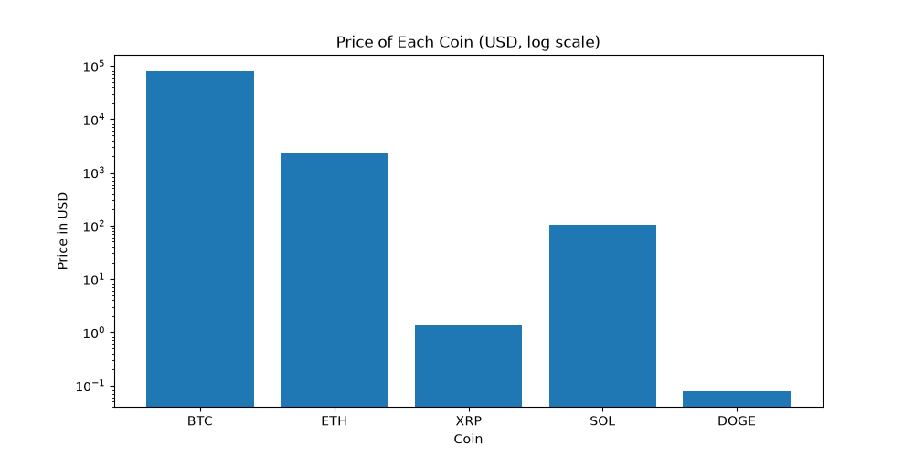
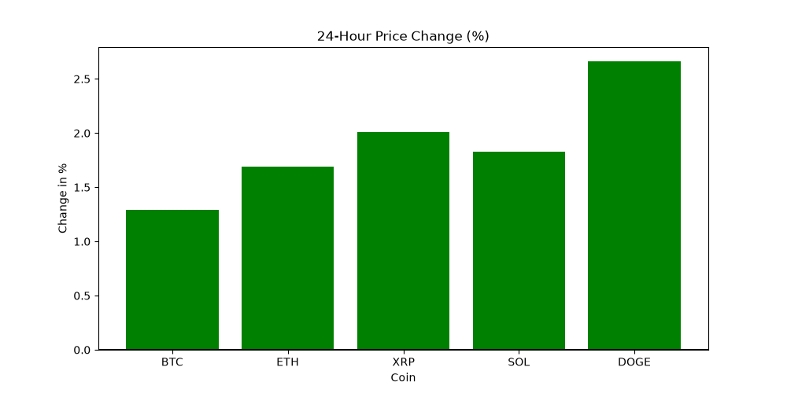
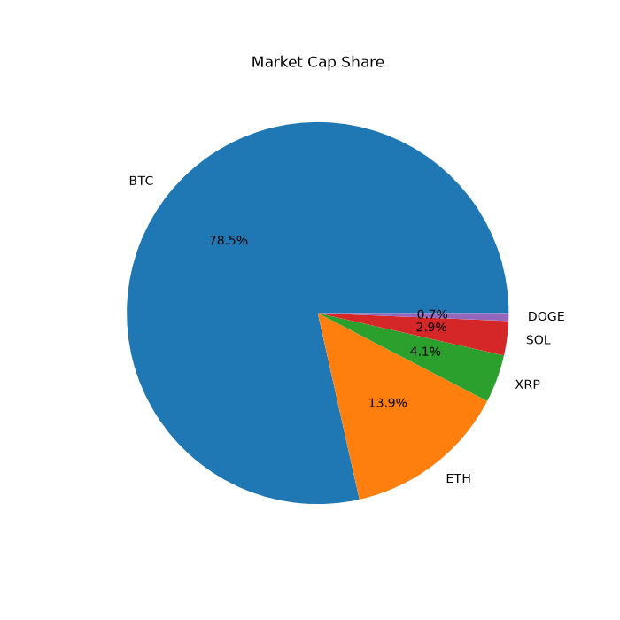
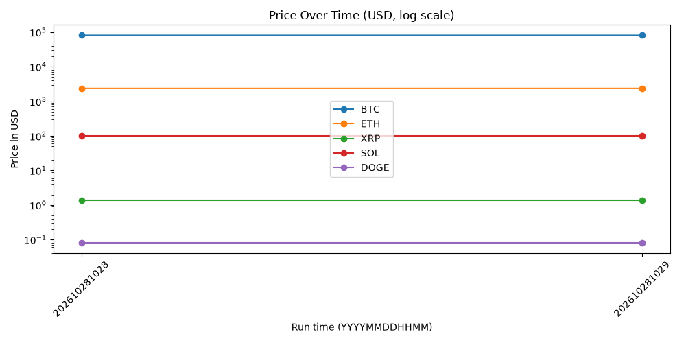

# Crypto Market Data ETL Pipeline

A beginner data engineering project. It gets **live crypto prices** from the free
[CoinPaprika API](https://api.coinpaprika.com/) (no API key needed), checks the data,
cleans it with **Pandas**, saves it in a **SQLite** database as a **star schema**, and draws charts.

Everything is in one notebook: [`crypto_etl_pipeline.ipynb`](crypto_etl_pipeline.ipynb).
Every code cell has a simple explanation above it.

## Pipeline

```
Extract  ->  Validate  ->  Transform  ->  Model  ->  Load  ->  Visualize
```

| Step | What it does |
|------|--------------|
| **Extract** | Gets data for 5 coins (BTC, ETH, XRP, SOL, DOGE) from the API |
| **Validate** | Checks for missing values, duplicate coins, prices of 0 or less, and wrong data types |
| **Transform** | Renames columns, rounds numbers, adds an `extracted_at` time |
| **Model** | Splits the data into 1 fact table and 2 dimension tables |
| **Load** | Saves the tables into `crypto.db` with no duplicates when run again |
| **Check with SQL** | Runs SQL queries with `JOIN`, `GROUP BY` and `ORDER BY` |
| **Visualize** | Draws 4 charts and saves them in the `charts` folder |

Every step also writes a message to `pipeline.log`.

## Tools used

- Python
- `requests`: call the API
- `pandas`: clean the data
- `sqlite3`: database (comes with Python)
- `logging`: log file
- `matplotlib`: charts
- Jupyter Notebook

## Star schema

```
      dim_coin                fact_prices                dim_date
  +------------+         +--------------------+        +-----------+
  | coin_id    |<--------| coin_id            |        | date_id   |
  | name       |         | date_id            |------->| date      |
  | symbol     |         | price_usd          |        | hour      |
  +------------+         | volume_24h         |        | day_name  |
                         | market_cap         |        +-----------+
                         | percent_change_24h |
                         +--------------------+
```

- **Fact table** (`fact_prices`): stores the numbers (price, volume, market cap). It gets new rows every run.
- **Dimension tables** (`dim_coin`, `dim_date`): store the details (which coin, which date).
- Each table has a **primary key**, and rows are added with `INSERT OR IGNORE`,
  so running the notebook again never creates duplicates.

## How to run

1. Install the libraries:
   ```bash
   pip install -r requirements.txt
   ```
2. Open `crypto_etl_pipeline.ipynb` in Jupyter or VS Code and click **Run All**.

Run it again later to add new prices and see the price-over-time chart grow.

## Charts

### Price of each coin


### 24-hour price change (green = up, red = down)


### Market cap share


### Price over time

